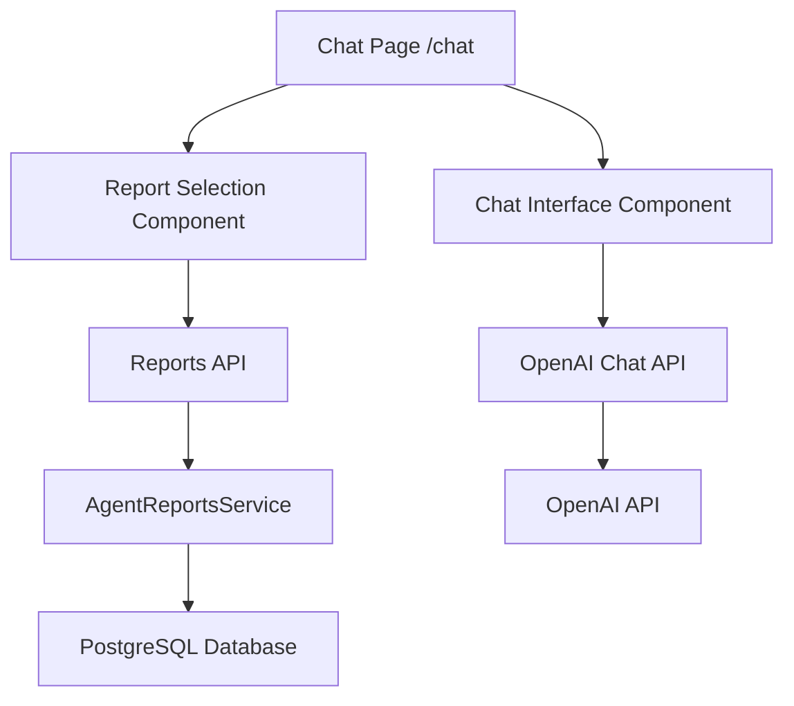

# Design Document

## Overview

The Financial Chat Interface is a dedicated `/chat` page that provides a ChatGPT-like experience for users to interact with OpenAI about their financial reports. The system allows users to select existing reports as context and engage in specialized conversations about stocks and financial markets using AI Elements UI components for a rich, responsive interface.

## Architecture

### High-Level Architecture



### Component Hierarchy

```
ChatPage
├── ReportSelector
│   ├── ReportList
│   └── SelectedReports
├── ChatInterface
│   ├── Conversation (AI Elements)
│   │   ├── ConversationContent
│   │   └── ConversationScrollButton
│   ├── MessageList
│   │   └── Message (AI Elements)
│   │       ├── MessageContent
│   │       └── MessageAvatar
│   └── PromptInput (AI Elements)
│       ├── PromptInputTextarea
│       ├── PromptInputFooter
│       └── PromptInputSubmit
└── ChatProvider (Context)
```

## Components and Interfaces

### 1. Chat Page Component (`/src/app/(main)/chat/page.tsx`)

Main page component that orchestrates the chat interface.

**Props:**
- None (page component)

**State:**
- Selected reports
- Chat messages
- Loading states

### 2. Report Selection Component

Allows users to browse and select reports for chat context.

**Props:**
```typescript
interface ReportSelectorProps {
  onReportsSelected: (reports: SelectedReport[]) => void;
  selectedReports: SelectedReport[];
}

interface SelectedReport {
  sessionId: string;
  ticker: string;
  analysisDate: Date;
  name: string;
  content: string; // Full report content for context
}
```

### 3. Chat Interface Component

Main chat interface using AI Elements components.

**Props:**
```typescript
interface ChatInterfaceProps {
  selectedReports: SelectedReport[];
  onSendMessage: (message: string) => Promise<void>;
  messages: ChatMessage[];
  isLoading: boolean;
}

interface ChatMessage {
  id: string;
  role: 'user' | 'assistant';
  content: string;
  timestamp: Date;
}
```

### 4. API Routes

#### `/api/chat/reports` - GET
Fetches available reports for selection.

**Response:**
```typescript
interface ReportsResponse {
  reports: {
    sessionId: string;
    ticker: string;
    analysisDate: Date;
    name: string;
    recommendation: string;
  }[];
}
```

#### `/api/chat/reports/[sessionId]` - GET
Fetches full report content for context.

**Response:**
```typescript
interface ReportContentResponse {
  sessionId: string;
  content: string; // Formatted report content
}
```

#### `/api/chat` - POST
Handles chat messages with OpenAI integration.

**Request:**
```typescript
interface ChatRequest {
  message: string;
  context: {
    reports: SelectedReport[];
  };
}
```

**Response:**
```typescript
interface ChatResponse {
  message: string;
  id: string;
}
```

## Data Models

### Chat Context Model

```typescript
interface ChatContext {
  reports: SelectedReport[];
  systemPrompt: string;
}
```

### Report Content Model

```typescript
interface ReportContent {
  sessionId: string;
  ticker: string;
  analysisDate: Date;
  sections: {
    marketAnalysis: string;
    newsAnalysis: string;
    fundamentalsAnalysis: string;
    socialSentiment: string;
    investmentDebate: {
      bullAnalysis: string;
      bearAnalysis: string;
      judgeDecision: string;
    };
    riskAssessment: {
      riskyAnalysis: string;
      safeAnalysis: string;
      neutralAnalysis: string;
      judgeDecision: string;
    };
    traderPlan: string;
    finalRecommendation: string;
  };
}
```

## Error Handling

### Client-Side Error Handling

1. **Network Errors**: Display toast notifications for API failures
2. **Validation Errors**: Show inline validation messages
3. **Loading States**: Use AI Elements loading components
4. **Empty States**: Use ConversationEmptyState component

### Server-Side Error Handling

1. **Authentication Errors**: Return 401 with clear error messages
2. **Validation Errors**: Return 400 with specific field errors
3. **OpenAI API Errors**: Return 500 with generic error message (don't expose API details)
4. **Database Errors**: Return 500 with generic error message

### Error Response Format

```typescript
interface ErrorResponse {
  error: string;
  code?: string;
  details?: Record<string, string>;
}
```

## Testing Strategy

### Unit Tests

1. **Component Tests**:
   - ReportSelector component selection logic
   - ChatInterface message handling
   - API route handlers

2. **Service Tests**:
   - OpenAI integration service
   - Report content formatting
   - Context building logic

### Integration Tests

1. **API Integration**:
   - Chat flow with OpenAI
   - Report fetching and context building
   - Authentication flow

2. **Component Integration**:
   - Report selection to chat context flow
   - Message sending and receiving
   - Error state handling

### E2E Tests (Optional)

1. **User Flows**:
   - Complete chat session with report selection
   - Error recovery scenarios
   - Responsive design validation

## Implementation Details

### Navigation Integration

Add chat route to `src/components/app-sidebar.tsx`:

```typescript
const data = {
  navMain: [
    {
      title: "Table View",
      url: "/table",
      icon: IconTable,
    },
    {
      title: "Chat",
      url: "/chat",
      icon: IconMessageCircle, // New icon
    },
  ],
  // ... rest of config
};
```

### OpenAI Integration

Use OpenAI SDK with streaming support:

```typescript
import OpenAI from 'openai';

const openai = new OpenAI({
  apiKey: process.env.OPENAI_API_KEY,
});

// System prompt for financial specialization
const FINANCIAL_SYSTEM_PROMPT = `
You are a financial analysis assistant specializing in stock market analysis and investment recommendations. 
You have access to detailed financial reports and should provide insights based on the provided context.
Focus on actionable investment advice, risk assessment, and market analysis.
`;
```

### Context Building

Format report data for OpenAI context:

```typescript
function buildChatContext(reports: SelectedReport[]): string {
  return reports.map(report => `
    Report for ${report.ticker} (${report.analysisDate}):
    ${report.content}
  `).join('\n\n---\n\n');
}
```

### State Management

Use React Context for chat state:

```typescript
interface ChatContextType {
  messages: ChatMessage[];
  selectedReports: SelectedReport[];
  isLoading: boolean;
  sendMessage: (message: string) => Promise<void>;
  selectReports: (reports: SelectedReport[]) => void;
  clearChat: () => void;
}
```

### AI Elements Usage

Maximize use of AI Elements components:

1. **Conversation**: Main chat container with auto-scroll
2. **Message**: Individual message display with avatars
3. **PromptInput**: Rich input with file attachment support (disabled for this use case)
4. **Loader**: Loading states during API calls
5. **Response**: Structured response display
6. **Shimmer**: Loading placeholders

### Responsive Design

- Mobile-first approach using Tailwind CSS
- Collapsible report selector on mobile
- Optimized chat interface for touch interactions
- Proper keyboard navigation support

### Performance Considerations

1. **Lazy Loading**: Load report content only when selected
2. **Message Virtualization**: For long chat histories (future enhancement)
3. **Debounced Input**: Prevent excessive API calls
4. **Caching**: Cache report content in memory during session
5. **Streaming**: Use OpenAI streaming for real-time responses

### Security Considerations

1. **Authentication**: Verify user session for all API calls
2. **Authorization**: Ensure users can only access their own reports
3. **Input Sanitization**: Sanitize user messages before sending to OpenAI
4. **Rate Limiting**: Implement rate limiting for chat API
5. **API Key Security**: Store OpenAI API key securely in environment variables